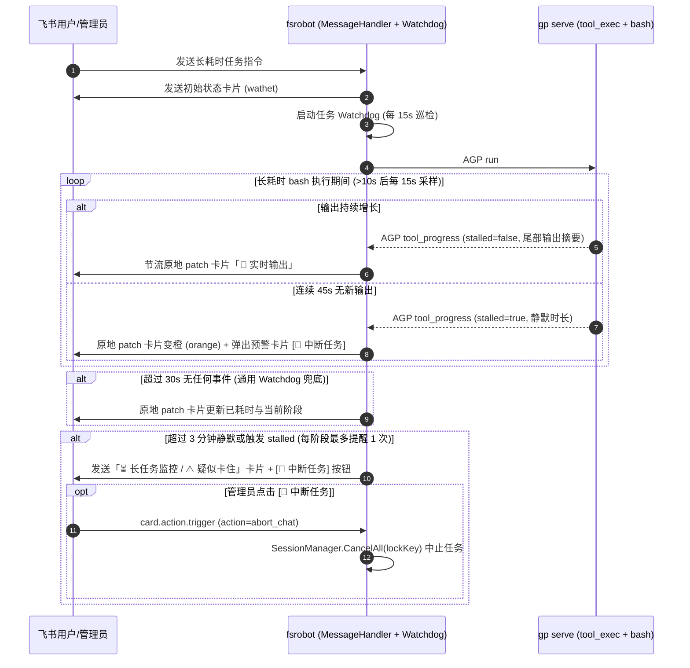

# 长任务 Watchdog 监控与进度推送方案

> **适用仓库**：`fsrobot`（飞书多 Agent 网关） + `gp`（Go Agent Harness）  
> **核心目标**：解决长耗时任务（如编译、下载、大仓库排查或命令等待输入）静默无事件时，用户只能手工发送 `/status` 查询的问题，实现「自动心跳保活 + 尾部输出采样 + 卡顿预警与一键中断」。

---

## 1. 架构与调用流程



---

## 2. 分层实现细节

### 2.1 `gp` 引擎侧：长工具输出采样与卡顿检测
1. **线程安全输出缓冲 + 采样器**（`gp/internal/tools/builtin/bash.go`）：
   - 使用 `syncOutputBuffer` 收集 `stdout`/`stderr`；
   - 命令执行超过 **10s** 后，每 **15s** 采样一次输出长度与最后一行有效文本：
     - 输出有新增：发送 `ToolEvent{ToolName: "bash", Action: "输出更新 (...): <tailLine>", Stalled: false}`；
     - 连续 **45s** 输出字节数无增长：标记 `Stalled: true`，提示已连续无新输出时长。
2. **事件透传链路**：
   - `gp/internal/agent/tool_exec.go` 为 `ToolContext.EventChan` 创建转发协程，将 `tools.ToolEvent` 转为 `agent.EventToolProgress`；
   - `gp/internal/agp/protocol.go` 与 `gp/internal/modes/rpc/server.go` 新增 `tool_progress` AGP 事件帧（含 `stalled` 字段）推向网关。

### 2.2 `fsrobot` 网关侧：Watchdog 巡检、防刷屏与一键中断
1. **协议与会话状态**（`internal/protocol/agp.go`、`internal/registry/registry.go`、`internal/agent/agp_client.go`、`internal/handler/session_mgr.go`）：
   - 解析 `tool_progress` 事件并透传给 `MessageHandler`；
   - `RunStatus` 新增 `UpdatedAt`，随 `UpdatePhase` 实时刷新。
2. **Watchdog 巡检逻辑**（`internal/handler/message.go`）：
   - 通过 `cardMu` 统一保护卡片状态与节流刷新，避免 Watchdog 与流式事件并发写乱卡片；
   - **30s 无新活动**：原地 `patch` 原状态卡，展示当前阶段与已持续耗时（不发新消息）；
   - **3m 无新活动 或 收到 `stalled: true`**：将状态卡标橙（`orange`），并发送**单次**长任务监控卡片（每个卡顿阶段最多发 1 次防刷屏），附带 **`[🛑 中断任务]`** 按钮；
   - **卡片按钮回调（`HandleCardAction`）**：响应 `action == "abort_chat"`，校验管理员权限（配置了 `bosses` 时）后调用 `h.sessions.CancelAll(lockKey)` 立即中止任务。

---

## 3. 测试验证方法

1. **快速验证 `tool_progress` + `stalled`**：
   在群里让 Agent 执行一条带间隔输出的命令，例如：
   ```text
   用 bash 执行：for i in 1 2 3; do echo "step $i"; sleep 18; done; sleep 50
   ```
   - 运行 10s~25s 后：状态卡会出现 `📡 实时输出：输出更新 (...): step 1` / `step 2`；
   - 进入最后 `sleep 50` 超过 45s 无新输出后：状态卡变橙并弹出 `⚠️ 任务疑似卡住` 卡片，可点击 **`🛑 中断任务`** 测试即时中止。
2. **单测命令**：
   - `gp`：`go test ./internal/tools/builtin/... ./internal/agent/...`（含 `TestBashToolEmitsProgressAndStalledEvents`）
   - `fsrobot`：`go test ./...`
